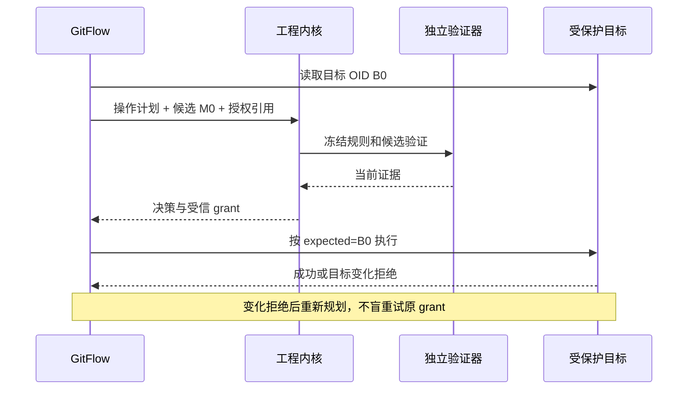

## Context

当前 v0.2.0 已有 `scripts/gitflow/ci.py` 从 base 提交读取规则、完整 OID 与提交范围检查，`rules.py` 为元数据规则，`service.py` 明确 quality_decision=not_evaluated。见现行 ci-governance/organization-policy；本 change 增加工程协作，不重写既有 GF 规则。行为见 [spec](specs/engineering-git-integration/spec.md)。

## Goals / Non-Goals

**Goals:** 为统一门禁提供 Git 身份、变更范围、合入候选与受控执行，并保留独立 GitFlow 使用。

**Non-Goals:** 不判断业务需求正确性，不执行候选里的策略代码，不用 Hook 代替服务端保护，不将 Git CLI 重写为另一套实现。

## Decisions

1. Python 3.11+ 标准库外壳和 argv Git 保留；通过版本化子进程/JSON 协议调用固定 Rust 内核，不引入 OPA Python 客户端或重复 Rego 规则。OPA 只组合 GF 检查结果，GF001 等规则仍由本仓维护。
2. `.gitflow/workflow.json` 与组织固定摘要基线继续权威；Registry 引用其 effective policy digest；共享内核不写 `.gitflow/state/`。无 Git 自动 Hook 静默、查询不 fetch、显式 apply 均不变。
3. Branch/Change Scope/Baseline 基础先实现；任务申报修改集合不是证据，按实际 diff 的新增/删除/rename/mode/submodule/公共契约变化复核。未知路径/动态 shell/不支持 Git 形态保持 unverified。
4. merge candidate 创建在临时受控仓，不修改用户分支。合入令牌绑定 repo、source/head、target/expected OID、candidate tree、策略/证据和操作授权。apply 前再次核验，最终由支持期望版本的引用更新或托管合并队列执行，目标变更则重建和重验。
5. 保留原生 GitFlow apply gate；只有显式启用受控模式才要求工程 grant。旧 Git allow 只满足元数据义务，CodeGuard/Architecture/FlowGuard/Review 证据各自独立。
6. P3 读取任务 changedSymbols 和 consumedApis、公共契约版本，发现不同文件间的语义冲突。缺图谱时不猜无冲突；可通过必需集成测试弥补契约允许的验证方式，但不能伪造图谱检查已完成。
7. CI 接口有 GitHub 和 GitLab 适配计划；固定执行器来源和受信 base，候选测试在无写凭据 runner 运行，控制端只消费验证产物。GitHub merge_group 或 GitLab 对应实际合入结果机制分别验收，不假定两个平台完全同义。

## Implementation surfaces

`scripts/gitflow/{service,ci,policy,rules,layout,cli}.py`、新增 engineering bridge、`action.yml`、schemas、tests 和 examples。现有 MCP 的十五工具不静默改变参数；新增输入通过版本能力协商。互斥只约束协作进程，不能声称阻止外部原始 Git。

## Risks / Trade-offs

- [服务端权限未接线] → doctor 标记 unverified，P0 实际保护验收后才宣布强制。
- [目标移动与未知远端结果] → expected OID + operationId + 对账日志；不 force/reset。
- [迁移重复规则] → GF 元数据结果作为独立证据，共享层只组合。
- [不同合并策略] → merge/squash/rebase 分别定义最终对象与验收；尚不支持的执行保持 unverified，不用 merge 测试替代。

## Migration Plan

P0 证据桥接、范围与合入候选；P1 架构/领域变更保护；P2 CI 平台与宿主矩阵；P3 语义冲突；P4 跨仓基线传播。先只读 shadow 再显式启用；回滚保留激活定义和日志，不撤除分支保护、不自行推送、删除分支或部署。

实施检查：临时仓库和本地 bare remote 的真实 Git 测试、unittest、validate_package、vendor_skills --check；GitHub/GitLab 实际 required check、保护、身份和合入竞态另留证据。
